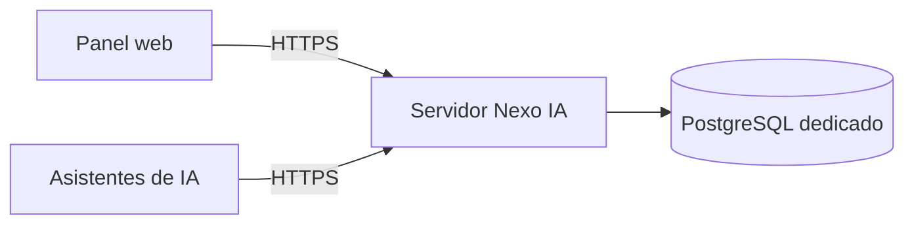

<h1 align="center">Nexo IA</h1>

<p align="center">
  <strong>El conocimiento del equipo, también en tu asistente.</strong><br>
  Estándares con fuentes, memoria de proyectos y un panel para gestionarlo todo.
</p>

<p align="center">
  <a href="NEXO_CHANGES.md"></a>
  <a href="go.mod"></a>
  <a href="LICENSE"></a>
</p>

<p align="center">
  <a href="#probar-la-demo">Probar la demo</a> ·
  <a href="#conectar-un-asistente">Conectar un asistente</a> ·
  <a href="docs/nexo/manuales/servidor-ubuntu.md">Instalar el servidor</a> ·
  <a href="#documentación">Documentación</a>
</p>

---

Nexo IA reúne el **conocimiento oficial y la memoria de proyectos** de equipos de ingeniería.
Consulta desde el panel web o desde tu asistente de IA, con permisos y trazabilidad.

Construido sobre [Engram](https://github.com/Gentleman-Programming/engram), añade espacios de
conocimiento con documentos versionados, revisión humana y control de acceso. Este repositorio
incluye el ejecutable `engram`, el servidor, el panel y las integraciones con asistentes.

**Estado: beta.** Puedes empezar con la demo local o preparar un servidor compartido siguiendo
la guía de instalación y sus requisitos.

> **Para instalar el servidor en Ubuntu, lee la [guía paso a paso](docs/nexo/manuales/servidor-ubuntu.md).**
> Incluye Git, Go, compilación, PostgreSQL externo, credenciales, HTTPS y arranque automático.

## Empieza aquí

| Quiero… | Por dónde empezar |
|---|---|
| Ver cómo funciona con datos de ejemplo | [Probar la demo local](#probar-la-demo) |
| Usarlo con el servidor de mi equipo | [Conectar mi PC y mi asistente](#conectar-un-asistente) |
| Instalar el cliente Windows sin compilar | [Descargar e instalar el ejecutable](#cliente-windows-sin-compilar) |
| Instalar el servidor para compartirlo | [Instalar desde cero en Ubuntu](docs/nexo/manuales/servidor-ubuntu.md) |

## Para qué sirve

| Cuando necesitas… | Nexo te permite… |
|---|---|
| Saber qué regla aplica | Consultar estándares con documento, sección, versión y vigencia |
| Compartir documentación del equipo | Publicar Markdown, texto o Word, una carpeta o un archivo ZIP |
| Actualizar una guía | Proponer un cambio y revisarlo antes de publicarlo |
| Retomar un proyecto | Recuperar decisiones, soluciones y pendientes guardados en su memoria |
| Administrar el acceso | Gestionar personas y permisos, y consultar la auditoría |

## Dos tipos de información

| | Conocimiento oficial | Memoria de proyectos |
|---|---|---|
| Qué contiene | Estándares, convenciones, lineamientos y guías del equipo | Decisiones, descubrimientos, soluciones y pendientes de un proyecto |
| Cómo se organiza | Espacios, documentos y secciones con versiones y vigencia | Proyectos y memorias de Engram |
| Quién publica | Responsables y publicadores del espacio; otras personas pueden proponer según su rol | Personas y asistentes con permiso sobre el proyecto |
| Desde el asistente | Herramientas `nexo_*` | Herramientas `mem_*` |

Una memoria de proyecto no se convierte automáticamente en un estándar oficial. Las propuestas
de conocimiento requieren revisión y aprobación de una persona autorizada.

### Cómo se usa en el equipo

1. **Organiza el conocimiento.** Crea espacios, asigna responsables y publica los documentos del equipo.
2. **Conecta a las personas.** Cada una recibe su acceso y configura su asistente contra el mismo servidor.
3. **Consulta y mejora.** Busca desde el panel o el asistente, guarda lo aprendido en cada proyecto
   y propone cambios a los documentos cuando corresponda.

El servidor aplica los permisos de cada identidad. La configuración de personas, espacios y
publicaciones se explica en el [manual de administración](docs/nexo/manuales/administracion.md).

<a id="get-started"></a>

## Probar la demo

Necesitas acceso al repositorio, Git, la versión de Go indicada en [go.mod](go.mod),
Docker Engine y Docker Compose v2. En Windows puedes usar Docker Desktop con el motor iniciado.

La demo levanta PostgreSQL con pgvector y el servidor Nexo, y carga personas, espacios y documentos
de ejemplo. Usa únicamente datos de prueba.

Los comandos siguientes usan `develop`, la rama de integración, para probar el código actual.
La guía de servidor Ubuntu usa `main` para una instalación estable.

**Windows, desde PowerShell:**

```powershell
git clone https://dev.azure.com/realplaza/AgentAI/_git/nexo-ai-playground engram-nexo
cd engram-nexo
git switch develop
go build -o engram.exe ./cmd/engram
if ($LASTEXITCODE -ne 0) { throw 'No se pudo compilar Nexo' }
.\engram.exe nexo stack up --mode demo --yes --no-tour --no-agents
```

**Linux o macOS:**

```sh
git clone https://dev.azure.com/realplaza/AgentAI/_git/nexo-ai-playground engram-nexo
cd engram-nexo
git switch develop
go build -o engram ./cmd/engram && ./engram nexo stack up --mode demo --yes --no-tour --no-agents
```

Abre la URL que indique el comando; por defecto, el panel está en
`http://127.0.0.1:18480/dashboard/`. Si el puerto está ocupado, Nexo puede elegir otro.

Los accesos se guardan en el archivo privado `accesos.md` del entorno; los tokens no se imprimen
en la terminal. Para abrirlo en Windows:

```powershell
.\engram.exe nexo stack accesos --mode demo --abrir
```

En Linux o macOS usa `./engram` en lugar de `.\engram.exe`. Entra al panel con uno de los accesos
del ejemplo y abre **Conocimiento** para explorar los espacios y sus documentos.

**Qué comprobar en la demo:** entra en un espacio, abre un documento y realiza una búsqueda.
Revisa la fuente y la versión de los resultados. Para recorrer la demo con ayuda, ejecuta el tour.

Para una configuración guiada, ejecuta `engram nexo start`. Para recorrer los pasos de la demo,
usa `engram nexo tour --mode demo`. Estos ejemplos usan `engram` disponible en el `PATH`;
si ejecutas el binario desde esta carpeta, conserva el prefijo de tu sistema.

### Detener y volver a iniciar

```sh
engram nexo stack status --mode demo
engram nexo stack down --mode demo
engram nexo stack up --mode demo --yes --no-tour --no-agents
```

`down` detiene el entorno y conserva sus datos. `reset` borra los datos y volúmenes locales
del entorno seleccionado: no hace falta para actualizar el ejecutable.

Para aplicar cambios del código, detén la demo, recompila y vuelve a iniciarla.
El [manual del stack](docs/nexo/manuales/stack.md) explica puertos, carpetas, nombres de entorno
y configuración de búsqueda.

## Cliente Windows sin compilar

Esta entrega incluye excepcionalmente [`engram.exe` para Windows Intel/AMD de 64 bits](bin/windows-amd64/engram.exe).
**No necesitas Go, Docker ni PostgreSQL en tu PC.** El instalador detecta Engram, conserva un
respaldo y reemplaza el ejecutable anterior cuando su ruta lo permite. Si no existe, lo instala
para tu usuario; no sobrescribe shims de gestores de paquetes ni borra memorias o credenciales.

Descarga el repositorio desde Azure con Git, o usa **Descargar ZIP** y descomprímelo:

```powershell
git clone --branch main https://dev.azure.com/realplaza/AgentAI/_git/nexo-ai-playground engram-nexo-cliente
if ($LASTEXITCODE -ne 0) { throw 'No se pudo descargar el repositorio' }
Set-Location engram-nexo-cliente
```

Cierra los asistentes y procesos de Engram. Desde la carpeta descargada, ejecuta una de estas
opciones; el mismo archivo funciona con **Windows PowerShell 5.1 y PowerShell 7**:

```powershell
# Windows PowerShell 5.1 (incluido en Windows)
powershell -NoProfile -ExecutionPolicy Bypass -File .\scripts\install-nexo-windows.ps1
```

```powershell
# PowerShell 7, si lo tienes instalado
pwsh -NoProfile -ExecutionPolicy Bypass -File .\scripts\install-nexo-windows.ps1
```

El permiso de ejecución se aplica solo a ese proceso. El [instalador](scripts/install-nexo-windows.ps1)
comprueba SHA256 y versión, crea el respaldo, copia el ejecutable y añade su carpeta al PATH de
usuario. Si falta Git, intenta instalarlo con winget; si detecta Claude Code, comprueba también
jq y curl. Los asistentes deben estar instalados aparte y tener acceso al repositorio de sus plugins.
Si winget necesita autorización de Windows, sigue su solicitud; si no está disponible, el script
indica qué dependencia instalar antes de reintentar.

**Al terminar muestra los comandos exactos** para verificar la versión y la ruta, conectar tu
código o token, consultar `nexo status` y configurar Codex, Claude Code u OpenCode. Abre una
terminal nueva y sigue esos pasos; el script no solicita ni muestra credenciales.

Para otro servidor o una carpeta específica:

```powershell
powershell -NoProfile -ExecutionPolicy Bypass -File .\scripts\install-nexo-windows.ps1 -ServerUrl https://nexo.ejemplo.com -InstallDirectory "$HOME\.nexo-bin"
```

La dirección anterior es un ejemplo. Sin `-ServerUrl`, utiliza el entorno de prueba
`https://nexo-34-51-82-225.sslip.io`. Con `-SkipDependencies` no instala herramientas con winget;
con `-NoPath` conserva el PATH y muestra comandos con la ruta completa para uso portable.

Antes de cambiar de versión, respalda la memoria existente con los asistentes cerrados, siguiendo
la [guía Windows](docs/nexo/manuales/cliente-windows-desde-codigo.md#2-si-ya-tienes-engram-oficial-cerrar-y-respaldar).
Si usabas otro servidor o rutas de datos personalizadas, revisa esa configuración antes de conectar.
Una compilación desde código puede mostrar fecha y commit sin el sufijo `-nexo`.

## Conectar un asistente

Si el equipo ya tiene un servidor Nexo, no necesitas levantar una demo ni instalar PostgreSQL
en tu PC. Necesitas nuestro ejecutable, la dirección del servidor y un acceso personal.

Con un código de activación entregado por el administrador:

```sh
engram nexo connect --server https://nexo.empresa.interno --activate-stdin
engram setup codex
```

La dirección es un ejemplo: sustitúyela por la del servidor del equipo. El código se solicita
sin mostrarlo en una terminal interactiva. Si recibiste un token, usa `--token-stdin`
en lugar de `--activate-stdin`; no lo escribas como argumento ni lo pegues en un chat.

En Windows puedes copiar solo el código y pasarlo desde el portapapeles:

```powershell
Get-Clipboard | engram nexo connect --server https://nexo-34-51-82-225.sslip.io --activate-stdin
```

Esa es la URL del entorno de prueba; usa la de tu equipo si es otra. Si ya tienes el token personal,
cambia `--activate-stdin` por `--token-stdin`.

Elige el comando de instalación correspondiente y reinicia el asistente después:

| Asistente | Comando |
|---|---|
| Codex | `engram setup codex` |
| Claude Code | `engram setup claude-code` |
| OpenCode | `engram setup opencode` |
| Pi | `engram setup pi` |

Si reemplazaste Engram oficial, repite el `setup` de cada asistente. Para Claude Code, si conservas
un registro MCP que apunta al ejecutable anterior, quítalo con `claude mcp remove engram --scope user`
y repite `engram setup claude-code`. Codex y Claude Code necesitan acceso de lectura a
`Adriel2503/engram-nexo` en GitHub para instalar el plugin del fork. Claude Code necesita además
`jq` y `curl` disponibles.

Consulta la [instalación para desarrolladores](docs/nexo/manuales/instalacion-dev.md) y la
[referencia de asistentes](docs/AGENT-SETUP.md) para los pasos y requisitos de cada integración.

## Instalar un servidor

**Si quieres instalar Nexo en una VM Ubuntu, sigue la
[guía completa de instalación](docs/nexo/manuales/servidor-ubuntu.md).**
Explica qué ejecutar, dónde colocar cada archivo y para qué sirve cada credencial.

Puedes alojar Nexo y PostgreSQL juntos o en máquinas distintas:



| Opción | Uso actual |
|---|---|
| `engram nexo stack up --mode demo` | Primera prueba local con datos de ejemplo |
| `engram nexo stack up --mode dev` | Entorno local de desarrollo; la carga de ejemplo aún tiene una corrección pendiente |
| `engram nexo stack up --mode prod` | Preparar un ensayo de producción con Docker y Caddy; se inicia agregando `--up` |
| `engram cloud serve` | Ejecutar el servidor directamente, por ejemplo como servicio en una VM |

Con el ejecutable directo no necesitas Docker para Nexo. Compila para el sistema y la arquitectura
de la VM; configura la base, la autenticación, HTTPS y el arranque automático del servicio.

PostgreSQL puede estar en otro servidor o en un servicio administrado. `ENGRAM_DATABASE_URL`
define la conexión de la aplicación y `NEXO_MIGRATION_DATABASE_URL` la de migraciones.
Usa una base dedicada, cuentas separadas y TLS verificado. La extensión `pgvector` permite
buscar por significado; sin ella, Nexo puede buscar por texto.

El stack también admite una base externa mediante `NEXO_STACK_DATABASE_URL` y
`NEXO_STACK_MIGRATION_DATABASE_URL`. En modo prod sigue necesitando Docker para Nexo y Caddy.
Su configuración inicial usa HTTPS local con CA interna; no configura por sí sola el dominio,
los certificados ni el acceso desde las PCs del equipo.

Los secretos se configuran fuera del repositorio. El procedimiento de despliegue, creación del
primer superadmin y operación está en el [manual del servidor](docs/nexo/manuales/servidor-produccion.md).
El despliegue real con base externa debe validarse en la infraestructura de destino.

<a id="for-agents"></a>

## Documentación

| Necesito… | Documento |
|---|---|
| Elegir por dónde empezar | [Manuales de Nexo](docs/nexo/manuales/README.md) |
| Entender la documentación propia y sus antecedentes | [Resumen de Nexo](docs/nexo/README.md) |
| Probar o administrar un entorno local | [Start, stack y tour](docs/nexo/manuales/stack.md) |
| Conectar mi PC y mi asistente | [Instalación para desarrolladores](docs/nexo/manuales/instalacion-dev.md) |
| Desplegar y operar el servidor | [Servidor de producción](docs/nexo/manuales/servidor-produccion.md) |
| Instalar desde cero en una VM Ubuntu | [Ejecutable, systemd y PostgreSQL externo](docs/nexo/manuales/servidor-ubuntu.md) |
| Gestionar usuarios, espacios y documentos | [Administración](docs/nexo/manuales/administracion.md) |
| Entender permisos y seguridad | [Roles](docs/nexo/roles/design.md) y [guía de despliegue](docs/nexo/seguridad/guia-despliegue.md) |
| Consultar los cambios del fork | [NEXO_CHANGES.md](NEXO_CHANGES.md) |
| Consultar comandos y herramientas de Engram | [Referencia completa](DOCS.md) y [arquitectura](docs/ARCHITECTURE.md) |
| Contribuir al código | [CONTRIBUTING.md](CONTRIBUTING.md) y [AGENTS.md](AGENTS.md) |

Algunos manuales conservan la versión con la que se redactaron. Para el contenido de la rama actual,
contrasta las instrucciones con la ayuda del ejecutable y el inventario de cambios del fork.

<details>
<summary>Referencia de Engram: memoria local y actualización de la sincronización</summary>

Engram conserva SQLite local como fuente de verdad para la memoria del cliente; su documentación
lo denomina **local SQLite**. Cloud agrega replicación y acceso compartido (**replication/shared access**).
El conocimiento oficial de Nexo se almacena por separado en PostgreSQL y tiene su propia copia local
de consulta; no reemplaza el modelo de memoria de Engram.

Para actualizar la sincronización de una memoria local existente, el flujo de Engram es:

```sh
engram cloud upgrade doctor --project <proyecto>
engram cloud upgrade repair --project <proyecto> --dry-run
engram cloud upgrade repair --project <proyecto> --apply
engram cloud upgrade bootstrap --project <proyecto>
engram cloud upgrade status --project <proyecto>
```

Ejecuta `repair --apply` solo si la comprobación previa indica cambios. Este flujo no instala
el servidor ni publica documentos de conocimiento. Revisa la
[referencia de actualización](DOCS.md#cloud-upgrade-flow) antes de usarlo con datos existentes.

</details>

## Origen y licencia

Nexo IA es una adaptación de [Engram, de Gentleman Programming](https://github.com/Gentleman-Programming/engram).
Conserva su núcleo de memoria y añade conocimiento oficial, permisos, auditoría y herramientas del equipo.

El proyecto se distribuye bajo la [licencia MIT](LICENSE). Se conserva la atribución original
a Alan Buscaglia y el aviso de licencia del proyecto base.
